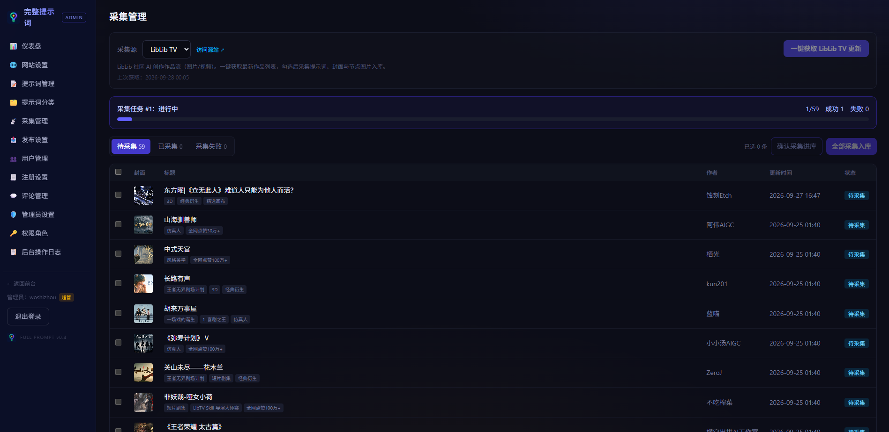

# 完整提示词 CompletePrompt（v0.5）

收集、分享、发现优质 AI 提示词的社区网站。内置 11000+ 条真实创作过程提示词（图片/视频/音频/文本），其中大量条目含与提示词分段精确对应的实拍效果图与视频截图，全部本地化存储。

## 图片展示

- 在线演示：https://www.wango8.com
- PC 端截图：
- 手机端截图：
- 一键采集截图：

## 功能介绍

### 前台
- **提示词浏览**：首页 Banner + 精选流 / 热门推荐 / 分类浏览（2 字母短码路由）/ 按创作类型浏览（文本/文生图/文生视频/文生音频）/ Meilisearch 全文搜索 / 标签筛选
- **详情页**：分段提示词（`[N] 标签｜…｜节点名`）与图片/视频截图精确对应、一键复制；作者/发布日期/观看/点赞图标元信息行；栏目与类型可点链接；自动中英翻译
- **用户系统**：注册登录（独立 JWT，HttpOnly Cookie）、个人中心、点赞、收藏、发布提示词；注册字段后台可配
- **评论系统**：两级嵌套回复、评论点赞、限频验证码防刷、敏感词屏蔽、单篇关评
- **会员体系**：free / Pro / VIP 三级，权益与价格后台可配置
- **响应式**：PC / 平板 / 手机三档自适应；手机端底部 Tab 导航，适配 iPhone 安全区
- **页脚友情链接**：后台配置，前台 copyright 上方一排小字展示

### 后台管理（隐蔽入口 `/guanli-7k2m9x`）
- 独立管理员体系（AdminAccount 与会员表完全隔离）、RBAC 多角色细粒度权限、操作日志只增不可改
- 仪表盘、提示词管理（全字段可编辑，含统计数字/来源/发布时间/媒体 JSON）、用户管理、评论管理、标签管理、分类管理
- 网站设置：站点信息 / SEO 关键字 / 页脚文字 / LOGO 与图标上传 / **首页 Banner 图（PC 横版 + 手机竖版）** / **友情链接** / Meili 同步间隔

## 一键采集

- 支持 **LibLib TV** 与 **即梦AI** 两个数据源，后台「采集管理」一键获取更新，自动去重，勾选或全部采集入库
- 自动拉取作品提示词全文、封面、节点图片与视频截图（sharp webp 化 + ffmpeg 截帧，全部本地化）
- 即梦视频作品正确解析 `text2video_params.video_gen_inputs.prompt`；空标题自动取提示词前 30 字兜底
- 待采列表支持批量删除（下次获取重进）与批量/单条「不采集」（永久跳过）；失败条目进「采集失败」Tab 可重试
- 后台异步任务 + 进度轮询，入库即上 Meili 索引；采集权限点 `crawl:manage` 可按角色分配

## 安装方法

### 本地开发

```bash
npm install                                   # 安装依赖（postinstall 自动 prisma generate）
cp .env.example .env                          # 复制环境变量并修改
npm run db:up                                 # 启动内嵌 PostgreSQL（端口 5432）
npm run db:push                               # 同步表结构
npm run seed                                  # 可选：导入示例数据
node scripts/create-admin.mjs admin 用户名 密码   # 创建管理员
npm run dev                                   # http://localhost:3000
```

> 本地搜索：下载 meilisearch 二进制后执行
> `bin\meilisearch.exe --db-path meili_data --http-addr 127.0.0.1:7700 --master-key dev-xxx`
>
> Meili 秒级同步守护进程（生产用）：`npm run meili:sync`

### 服务器部署（宝塔 + Docker）

详细步骤见 [docs/server-部署指南.md](docs/server-部署指南.md)，概要：

```bash
# 1. 启动数据库与搜索（PG 反代 127.0.0.1:35432 / Meili 7700）
docker compose up -d

# 2. 建库并恢复数据
docker exec -it postgresql_18_kpJt psql -U woshizhou -d postgres -c "CREATE DATABASE prompthub;"
pg_restore --host 127.0.0.1 --port 35432 --username woshizhou --dbname prompthub --no-owner database/prompthub-dump.dump

# 3. 配置 .env（数据库/Meili/JWT_SECRET/站点 URL）
# 4. 安装依赖并构建，PM2 托管
npm install && npm run build
pm2 start ecosystem.config.cjs
# 5. 宝塔 Nginx 反代 3000 端口 + SSL；Meili 反代 meili.域名.com
```

### 媒体文件传输（重要）
`public/uploads/` 约 4GB / 7 万文件，**不在 git 内**，部署时需单独传输到服务器同路径：
- 宝塔文件管理上传压缩包解压；或 `scp -r public/uploads root@服务器:/www/wwwroot/CompletePrompt/public/`
- 部署后 `chown -R www:www public/uploads`（PM2 以 www 用户运行）

## 版权说明

提示词数据采集自公开社区，版权归原作者所有；如有需要联系站长（页脚 Telegram）。
